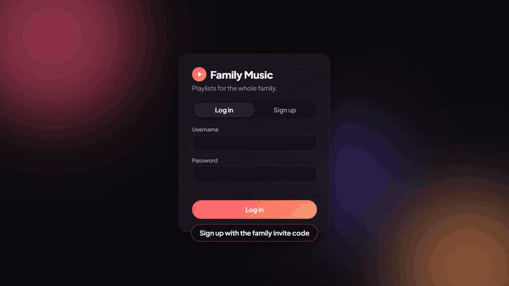

# Family Music

A small family playlist app. Search songs through the iTunes Search API, build playlists, mark them **public** (whole family sees them) or **private** (only you), and play 30-second previews.



▶ [Full-quality demo video (MP4, 42s)](demo/family-music-demo.mp4)

## Run it

```powershell
.venv\Scripts\python -m uvicorn main:app --reload
```

Open http://localhost:8000.

First time on a new machine:

```powershell
python -m venv .venv
.venv\Scripts\python -m pip install -r requirements.txt
```

## Family invite code

Signing up needs an invite code. The default is `family2026`. Change it by setting an env var before starting:

```powershell
$env:INVITE_CODE = "your-own-code"
```

## Files

| File | What it does |
|---|---|
| `main.py` | All API routes + serves the frontend |
| `db.py` | SQLite tables (`users`, `songs`, `playlists`, `playlist_songs`) |
| `auth.py` | Password hashing (bcrypt), JWT login tokens, current-user check |
| `itunes.py` | iTunes Search API call |
| `static/` | Frontend: `index.html`, `app.js`, `style.css` |
| `family_music.db` | The database (created on first run) |
| `.secret_key` | Random key used to sign login tokens (created on first run, keep private) |

API docs (auto-generated): http://localhost:8000/docs

## Rules enforced on the server

- Every route except login/register needs a logged-in user.
- Private playlists return 404 to anyone but the owner.
- Only the owner can rename, change visibility, add/remove songs or delete a playlist.
- Song links are only accepted if they point at Apple (`apple.com` / `mzstatic.com`).

## Apple's terms for previews

Previews stream straight from Apple's servers (never downloaded or re-hosted), and the player always shows a "Listen on Apple Music" link back to the track.

## Ideas for v2

- Full-length playback via YouTube embedded player (visible player required by YouTube's terms)
- Reorder songs in a playlist
- Deploy online (Render/Railway + HTTPS)
